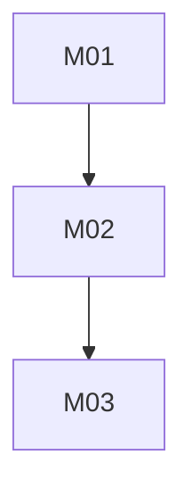

## Milestones
| id | name | dependencies | chunks | verification-mode | baseline-floor | acceptance-checks | decision-basis |
| :-- | :-- | :-- | :-- | :-- | :-- | :-- | :-- |
| M01 | Foundation | - | chunk-m01 | machine-checkable | none | Run `pytest -n 4 tests/test_noisy.py` and capture PASS/FAIL. | fixture |
| M02 | Cut over with rollback intact | M01 | chunk-m02 | machine-checkable | M01 | Run `pwsh -NoProfile -File tests/slow.ps1` and capture PASS/FAIL. | fixture |
| M03 | JSON artifact extraction | M02 | chunk-m03 | machine-checkable | M02 | Run `python scripts/repair_campaign_manifest.py --fixture tests/fixtures/service_split/v1/campaign-3.json --preview` and capture PASS/FAIL. | fixture |

## Chunks
| chunk-slug | milestone-id | model-routing | reference-pack-entitlement |
| :-- | :-- | :-- | :-- |
| chunk-m01 | M01 | codex | contracts, glossary |
| chunk-m02 | M02 | codex | contracts, glossary |
| chunk-m03 | M03 | codex | contracts, glossary |

## Verification Manifest
| check-id | milestone-id | execution-scope | prerequisites | mode | procedure |
| :-- | :-- | :-- | :-- | :-- | :-- |
| chk-m01-first | M01 | integration | none | machine-checkable | Run an end-to-end check with `pwsh -NoProfile -File tests/noisy.ps1`. |
| chk-m01 | M01 | integration | none | machine-checkable | Run `pytest -n 4 tests/test_noisy.py` and `pwsh -NoProfile -Command Invoke-Pester tests/noisy.Tests.ps1`, then count tokens with tiktoken; capture PASS/FAIL. |
| chk-m02 | M02 | integration | M01 | machine-checkable | Run `pwsh -NoProfile -File tests/slow.ps1` and capture PASS/FAIL. |
| chk-m03 | M03 | integration | M02 | machine-checkable | Run `python scripts/repair_campaign_manifest.py --fixture tests/fixtures/service_split/v1/campaign-3.json --preview` and capture PASS/FAIL. |

## Dependency Graph (Mermaid)

## Sequential Gantt (Mermaid)

```mermaid
gantt
  title Fixture
  dateFormat X
  section Build
  M01 :m01, 0, 1
  M02 :m02, after m01, 1
```
